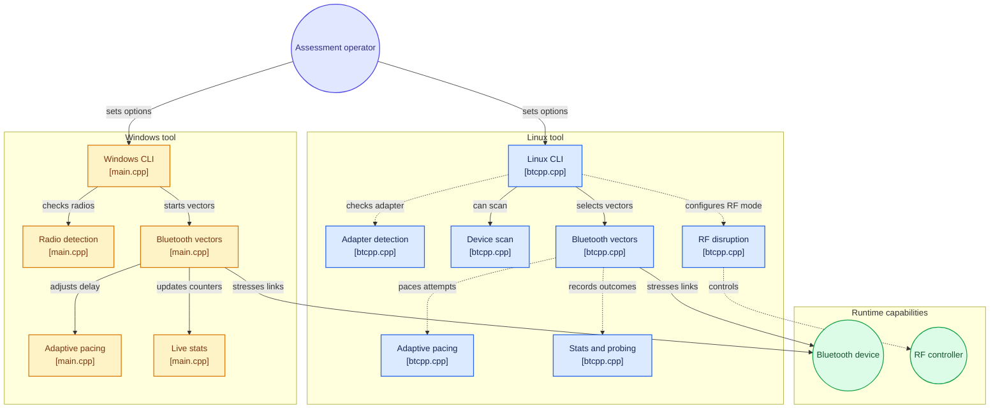

<div align="center">


# BTKILL

### BLUETOOTH MULTI-VECTOR STRESS TESTING TOOL


**TEST · ANALYZE · STRENGTHEN**

Bluetooth resilience testing for authorized security assessments.

</div>

---

## 01 / OVERVIEW

**BTKILL** is a multi-vector Bluetooth testing tool designed to assess connection resilience, service-discovery behavior, and device responses under controlled testing conditions.

The project combines operational statistics, adaptive pacing, and hardware diagnostics to support authorized Bluetooth security assessments.

> [!CAUTION]
> **AUTHORIZED TESTING ONLY**
>
> Use this software only on devices you own or have explicit authorization to test. Unauthorized Bluetooth interference may disrupt communications and violate applicable laws.

---

## 02 / ARCHITECTURE



---

## 03 / FEATURES

| FEATURE | DESCRIPTION |
|:--|:--|
| **Adaptive Pacing** | Adjusts the operation rate according to observed outcomes. |
| **Live Statistics** | Reports operations per second and success/failure counters. |
| **Hardware Diagnostics** | Detects Bluetooth adapter availability and provides diagnostic information. |
| **Multi-Vector Architecture** | Organizes supported Bluetooth testing methods in one command-line tool. |

---

## 04 / TESTING VECTORS

| TESTING VECTOR | LINUX | WINDOWS |
|:--|:--:|:--:|
| L2CAP Churn | SUPPORTED | LIMITED* |
| HCI Create Connection | SUPPORTED | UNAVAILABLE* |
| RFCOMM Sweep | SUPPORTED | SUPPORTED |
| SCO Probe | SUPPORTED | UNAVAILABLE* |
| Inquiry Testing | UNAVAILABLE | SUPPORTED |
| SDP Testing | UNAVAILABLE | SUPPORTED |

\*Platform support depends on the operating system, Bluetooth adapter, drivers, permissions, and available APIs. Verify these capabilities against the actual implementation.

---

## 05 / SYSTEM REQUIREMENTS

### Linux / Kali Linux

- Compatible Bluetooth adapter
- Bluetooth drivers and system services
- C/C++ build tools when compiling from source
- Appropriate permissions for authorized testing

### Windows

- Compatible Bluetooth adapter
- Supported Bluetooth drivers and Windows APIs
- Appropriate build tools when compiling from source

---

## 06 / INSTALLATION

### Linux / Kali Linux

**Step 01 — Clone the repository**

```bash
git clone https://github.com/Parham-Dehghan/btkill.git
cd btkill
```

**Step 02 — Prepare the installer**

```bash
chmod +x install.sh
```

**Step 03 — Run the installer**

```bash
./install.sh
```

> [!IMPORTANT]
> Review `install.sh` before running it. Confirm that the repository URL and installation commands match the current project.

---

## 07 / COMMAND LINE

Display the available command-line options:

```bash
./btkill --help
```

The executable name and available arguments may vary depending on the build configuration.

---

## 08 / TELEMETRY

| METRIC | DESCRIPTION |
|:--|:--|
| OPS/S | Operations per second |
| SUCCESS | Successful operations |
| FAILURE | Failed operations |
| ADAPTER | Bluetooth hardware diagnostics |
| CONNECTION | Connection-attempt outcomes |

Actual measurements depend on the hardware, drivers, operating system, and testing environment.

---

## 09 / RESPONSIBLE USE

- Test only devices you own or are authorized to assess.
- Use a controlled testing environment.
- Avoid disrupting third-party Bluetooth communications.
- Follow applicable laws and organizational security policies.
- Stop testing if unintended interference occurs.

---

## 10 / LICENSE

**PROPRIETARY SOFTWARE — ALL RIGHTS RESERVED**

Copyright (c) 2026 Mohammad Parham Dehghan.

Use, modification, redistribution, and commercial exploitation are subject to the terms of the proprietary license and applicable law.

See `LICENSE` for the full terms.

---

<div align="center">


**BTKILL**

BLUETOOTH SECURITY · RESILIENCE TESTING

Developed by Mohammad Parham Dehghan

</div>
